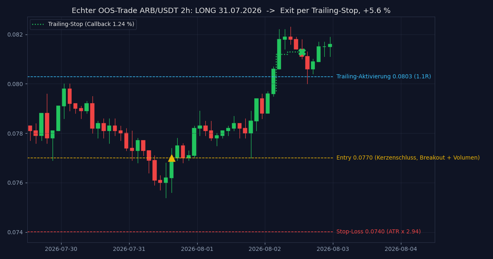
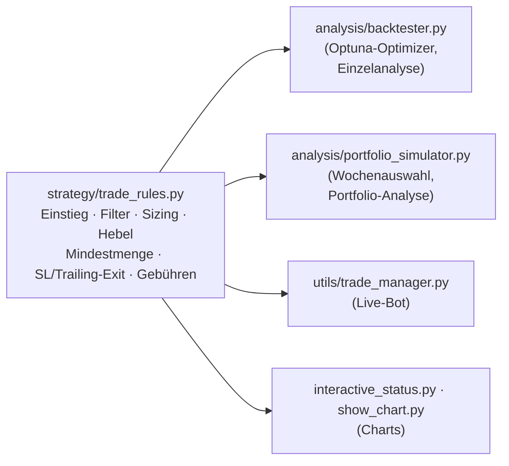
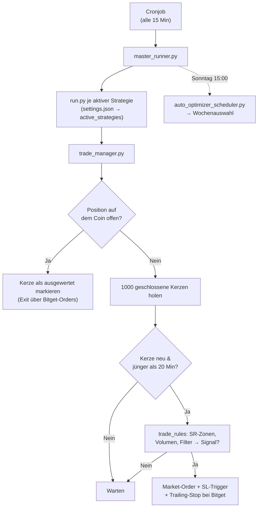
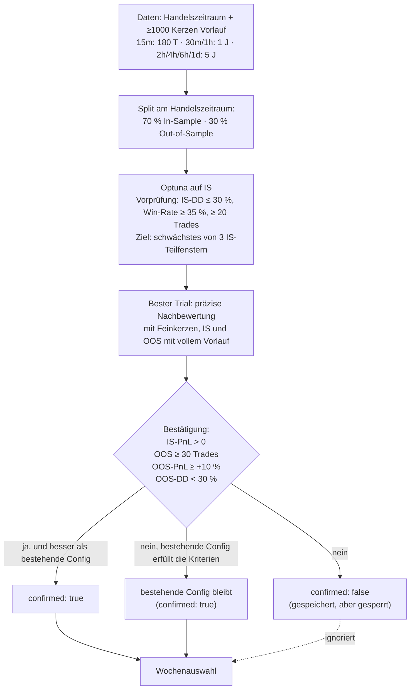
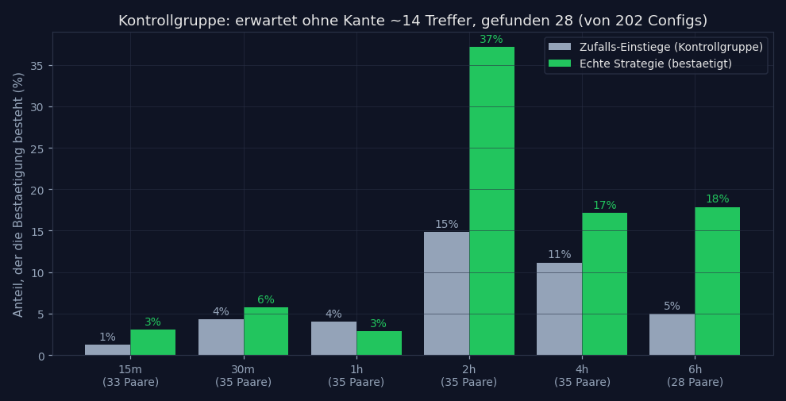
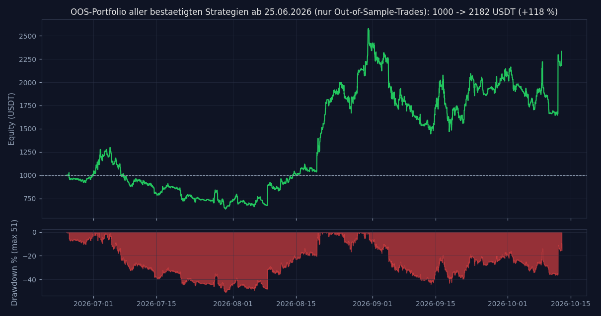

# StBot

Ein vollautomatischer Trading-Bot für Krypto-Futures auf der Bitget-Börse, basierend auf der **Support & Resistance Dynamic v2 (SRv2)** Strategie.

Dieses System wurde für den Betrieb auf einem Ubuntu-Server entwickelt und umfasst neben dem Live-Trading-Modul eine automatisierte Pipeline zur Parameter-Optimierung (Optuna, mit echter In-Sample/Out-of-Sample-Validierung gegen Overfitting), eine wöchentliche Portfolio-Zusammenstellung und Prüfwerkzeuge, die belegen, dass **Backtest und Live-Bot identisch handeln**.

---

## Kernstrategie 🧱

Der Bot handelt Ausbrüche aus dynamischen Unterstützungs- und Widerstandszonen.

* **Dynamische Pivot-Punkte:** Lokale Hochs und Tiefs über `pivot_period` Kerzen. Berücksichtigt werden höchstens `max_pivots` Pivots aus den **letzten 800 Kerzen** — dadurch hängt das Signal nicht davon ab, wie viel Historie geladen wurde (Live sieht 1000 Kerzen, Backtest ebenfalls mindestens 1000 Kerzen Vorlauf).
* **S/R-Zonen:** Pivots in einem engen, ATR-basierten Preisbereich (`channel_width_pct`) bilden eine Zone; nur Zonen mit mindestens `min_strength` Berührungen zählen.
* **Einstieg (bei Kerzenschluss):**
    * **Long:** Schluss > Zonenmitte + 0,2 %, vorherige Kerze darunter. **Short:** spiegelbildlich.
    * **Volumen-Bestätigung:** Volumen der Signal-Kerze ≥ 120 % des Schnitts der letzten 20 Kerzen.
    * **Optionale Filter (vom Optimizer je Paar gewählt):** Energie-Z-Score, Avalanche-Perzentil, steigende Energie (3 Kerzen), Wochentrend (EMA auf Wochenkerzen, Wochen Mo–Mo, gültig ab Wochenschluss), HTF-Trend.
* **Ausstieg — genau zwei Orders bei Bitget, keine feste Take-Profit-Order:**
    * **Stop-Loss** (Trigger-Market) im Abstand `max(ATR × atr_multiplier_sl, min_sl_pct)`.
    * **Trailing-Stop** (Bitget `track_plan`), aktiv ab `trailing_stop_activation_rr` × SL-Abstand im Gewinn, zieht mit `trailing_stop_callback_rate_pct` nach.
* **Positionsgröße & Hebel:**
    * Risiko = `risk_per_trade_pct` vom **realisierten Kapital** (Kontowert − unrealisierte PnL); Notional höchstens 10 × Kapital.
    * Hebel = `min(Config-Hebel, ⌊0,8 / SL-Abstand⌋)` — der Stop-Loss liegt so immer vor der Liquidation (isolierte Margin).
    * Orders unter der Bitget-Mindestmenge bzw. unter 5 USDT werden nicht platziert.



*Erzeugt aus echten Daten mit `python docs/make_illustrations.py trade` — Einstieg, Stop-Loss, Aktivierung und Trailing-Verlauf werden mit denselben Funktionen berechnet wie im Live-Bot.*

---

## Backtest = Live-Bot 🔁

Alle Handelsregeln (Signal, Filter, Volumen, Positionsgröße, Hebel, Mindestmenge, Stop-Loss, Trailing-Exit, Gebühren) liegen in **einem** Modul: `src/stbot/strategy/trade_rules.py`. Es wird von allen Pfaden aufgerufen:



Zusätzliche Regeln, damit Live sich exakt wie der Backtest verhält:

* **Jede geschlossene Kerze wird genau einmal bewertet.** Ein Signal, das während einer offenen Position kommt, verfällt (wie im Backtest).
* **Nur frische Signale:** Live steigt nur ein, wenn die Signal-Kerze vor höchstens 20 Minuten geschlossen hat (Cron alle 15 Min). Ältere Signale — z. B. wenn eine Strategie gerade neu ins Team gekommen ist — verfallen.
* **Eine Position je Coin**, auch wenn mehrere Timeframes desselben Coins aktiv sind.
* **Nur geschlossene Kerzen:** die laufende Kerze wird beim Abruf verworfen.

**Nachweis:** `tests/parity_check.py` lässt für jede Config den echten Live-Code gegen eine Mock-Börse laufen (15-Minuten-Takt, nur zu diesem Zeitpunkt bekannte Kerzen) und vergleicht mit Backtester und Portfolio-Simulator — jeder Trade (Einstieg, Exit, Preis, PnL) bzw. jeder Live-Einstieg muss identisch sein. Stand Oktober 2026: **28/28 bestätigte Configs identisch.**

```bash
.venv/bin/python3 tests/parity_check.py                                   # alle Configs
.venv/bin/python3 tests/parity_check.py --configs ARBUSDTUSDT_2h --start 2026-08-01
```

---

## Architektur & Arbeitsablauf



1. **Cronjob:** startet alle 15 Minuten den Master-Runner.
2. **Master-Runner:** startet für jede aktive Strategie aus `settings.json` einen Durchlauf und prüft wöchentlich, ob die Portfolio-Auswahl fällig ist.
3. **trade_manager.py:** wertet die zuletzt geschlossene Kerze mit `trade_rules` aus und platziert Einstieg, Stop-Loss und Trailing-Stop. Der Ausstieg passiert danach vollständig über die Bitget-Orders.

---

## Installation 🚀

Führe die folgenden Schritte auf einem frischen Ubuntu-Server (oder lokal) aus.

#### 1. Projekt klonen

```bash
git clone https://github.com/Youra82/stbot.git
cd stbot
```

#### 2. Installations-Skript ausführen

```bash
chmod +x install.sh
bash ./install.sh
```

#### 3. API-Schlüssel eintragen

```bash
cp secret.json.example secret.json
nano secret.json
```

*(Der Hauptschlüssel in der JSON-Datei heißt `"stbot"`.)* Speichern mit `Strg + X`, `Y`, `Enter`.

> **Wichtig:** Alle Python-Befehle mit `.venv/bin/python3` ausführen — das System-`python3` hat die Pakete (z. B. `tqdm`) nicht.

---

## Strategien finden & bestätigen 🔬

#### 1. Pipeline (Optuna-Optimierung)

```bash
chmod +x *.sh
./run_pipeline.sh
```

Standard-Antworten: Startdatum `a` (automatisch), Startkapital 1000, 200 Trials, Strenger Modus, Max-DD 30 %, Min-Win-Rate 35 %, Min-PnL 0.



* **Kein Kaltstart:** IS, OOS und die drei IS-Teilfenster werden mit der vollen Historie davor als Vorlauf bewertet (`run_backtest(trade_start=…)`) — wie ein Live-Bot, der an dem Tag startet.
* **Lange Historie für langsame Timeframes:** damit der OOS-Teil überhaupt 30 Trades enthalten kann (bei 4h/6h sonst nur ~15).
* **Trial-Skalierung je Timeframe:** 1d = 100 %, 6h/4h = 25 %, 15m = 20 %, 30m/1h/2h = 15 % der eingegebenen Trials, mindestens 30.
* **Bestehende Configs bewerten ohne neu zu optimieren:**
  ```bash
  .venv/bin/python3 src/stbot/analysis/optimizer.py --symbols ETH --timeframes 1h \
      --start_date 2025-10-13 --end_date 2026-10-13 --jobs 1 --max_drawdown 30 \
      --start_capital 1000 --min_win_rate 35 --trials 30 --min_pnl 0 --mode strict --evaluate_only
  ```

#### 2. Kontrollgruppe: wie viel ist Zufall?

`tests/random_baseline_check.py` ersetzt die Einstiege jeder Config durch **zufällige Einstiege** (zufällige Richtung, gleiche Häufigkeit) — Exit, Stop-Loss, Positionsgröße, Gebühren und IS/OOS-Aufteilung bleiben identisch — und zählt, wie oft das die Bestätigung trotzdem besteht.

```bash
.venv/bin/python3 tests/random_baseline_check.py alle kontrollgruppe.csv
```



**Ergebnis (Oktober 2026, 202 Configs):** Ohne jede Kante wären ~14 Treffer zu erwarten, gefunden wurden 28. Die Strategie hat also insgesamt eine echte Kante — aber **etwa die Hälfte der bestätigten Configs wäre auch zufällig durchgekommen.** Ursache ist der Trailing-Exit: Er lässt Gewinner laufen und begrenzt Verluste, und das verdient in den starken Trends 2025/26 auch mit zufälligen Einstiegen, besonders auf 2h und 4h. Auf 15m–1h ist der Zufallsanteil gering (1–4 %).

#### 3. Ergebnisse analysieren

```bash
./show_results.sh
```

* **Modus 1:** Einzelstrategien prüfen.
* **Modus 2:** Manuelles Portfolio zusammenstellen.
* **Modus 3:** Automatische Portfolio-Optimierung.

---

## Bestätigte Strategien (Stand 14.10.2026) 📊

28 von 202 Configs (35 Coins × 6 Timeframes, BTC zusätzlich 1d) erfüllen alle Kriterien. „Zufall“ = Anteil der Zufalls-Einstiege derselben Config, die die Bestätigung ebenfalls bestehen (niedriger = belastbarer).

| Strategie | IS-PnL | OOS ab | OOS-Trades | OOS-PnL | OOS-DD | OOS-WR | Zufall |
|---|---|---|---|---|---|---|---|
| MAGIC/2h | +1505 % | 2025-09-04 | 107 | +174,8 % | 23,6 % | 52 % | 40 % |
| ARB/2h | +57 % | 2025-09-18 | 39 | +67,7 % | 10,7 % | 62 % | 20 % |
| HBAR/2h | +294 % | 2025-09-16 | 81 | +57,8 % | 23,2 % | 30 % | 10 % |
| TAO/2h | +953 % | 2026-01-11 | 48 | +54,7 % | 28,5 % | 33 % | 20 % |
| ETH/4h | +404 % | 2025-04-13 | 64 | +52,1 % | 16,4 % | 55 % | 20 % |
| ENA/15m | +92 % | 2026-08-20 | 48 | +45,9 % | 6,9 % | 60 % | 0 % |
| ADA/2h | +195 % | 2025-04-13 | 93 | +41,9 % | 19,0 % | 34 % | 10 % |
| SOL/4h | +52 % | 2025-04-13 | 32 | +40,4 % | 12,0 % | 59 % | 0 % |
| XRP/4h | +30 % | 2025-04-13 | 52 | +38,2 % | 14,8 % | 56 % | 10 % |
| AAVE/6h | +39 % | 2025-04-13 | 33 | +32,6 % | 8,2 % | 54 % | 10 % |
| WLD/2h | +138 % | 2025-10-25 | 56 | +32,5 % | 12,3 % | 55 % | 10 % |
| LINK/6h | +75 % | 2025-04-13 | 33 | +31,4 % | 4,7 % | 64 % | 30 % |
| TIA/2h | +258 % | 2025-11-24 | 74 | +29,9 % | 24,6 % | 50 % | 30 % |
| ETH/1h | +26 % | 2026-06-25 | 31 | +28,6 % | 6,9 % | 48 % | 0 % |
| RSR/2h | +210 % | 2025-06-25 | 78 | +27,4 % | 25,2 % | 30 % | 30 % |
| BNB/4h | +20 % | 2025-04-13 | 45 | +25,6 % | 6,8 % | 49 % | 10 % |
| XLM/6h | +86 % | 2025-04-13 | 35 | +24,8 % | 22,8 % | 37 % | 10 % |
| AVAX/30m | +84 % | 2026-06-25 | 36 | +24,6 % | 7,7 % | 56 % | 30 % |
| ENA/2h | +51 % | 2026-01-09 | 37 | +24,4 % | 8,8 % | 43 % | 10 % |
| ADA/4h | +25 % | 2025-04-13 | 32 | +23,8 % | 7,5 % | 50 % | 0 % |
| XRP/6h | +23 % | 2025-04-13 | 31 | +23,8 % | 5,2 % | 61 % | 20 % |
| STRK/2h | +45 % | 2025-12-27 | 38 | +20,4 % | 7,6 % | 55 % | 40 % |
| DOGE/2h | +33 % | 2025-04-13 | 92 | +16,4 % | 12,1 % | 51 % | 30 % |
| BCH/2h | +149 % | 2025-04-13 | 60 | +15,2 % | 26,4 % | 43 % | 20 % |
| BTC/4h | +64 % | 2025-04-13 | 34 | +14,5 % | 11,5 % | 41 % | 10 % |
| AAVE/2h | +14 % | 2025-04-13 | 40 | +13,6 % | 11,2 % | 50 % | 0 % |
| BTC/6h | +71 % | 2025-04-13 | 40 | +10,5 % | 10,9 % | 48 % | 20 % |
| BNB/30m | +21 % | 2026-06-25 | 52 | +10,1 % | 16,8 % | 38 % | 30 % |

**Alle bestätigten Strategien gleichzeitig** — nur Out-of-Sample-Trades, gemeinsames Fenster ab 25.06.2026, 1000 USDT Start:



1000 → 2182 USDT (+118 %) in 3,5 Monaten, aber **51 % Drawdown**. Alle Strategien gleichzeitig zu handeln ist deutlich riskanter als jede einzelne — deshalb wählt die Wochenauswahl ein Team von höchstens `max_open_positions` Strategien unter einer Drawdown-Grenze.

---

## Wochenauswahl (Portfolio) 🗓️

`auto_optimizer_scheduler.py` startet sonntags um 15:00 `run_portfolio_optimizer.py`:

* **Kapital:** `portfolio_capital: "live"` → echter Bitget-Kontostand (Mindestmengen hängen davon ab). Ist er nicht abrufbar, bricht der Lauf ab und meldet das per Telegram.
* **Zeitraum:** die letzten `backtest_lookback_weeks` (26) Wochen; gehandelt wird erst ab diesem Startdatum, die Kerzen davor sind nur Vorlauf.
* **Kandidaten:** nur `confirmed: true`.
* **Greedy-Suche:** beste Einzelstrategie, dann jeweils die Ergänzung mit dem höchsten Endkapital, solange der Portfolio-DD ≤ 30 % bleibt, höchstens ein Timeframe je Coin und höchstens `max_open_positions` (7) Strategien.
* Das neue Team wird nur übernommen, wenn es im selben Zeitraum besser ist als das aktuelle.

> **Hinweis zur Einordnung:** Das 26-Wochen-Fenster überschneidet sich bei Strategien mit kurzem OOS-Zeitraum (z. B. ENA/15m, AVAX/30m) mit ihrem Optimierungszeitraum. Die gemeldete 26-Wochen-Rendite ist deshalb optimistischer als eine echte Erwartung; realistischer ist der reine OOS-Backtest oben.

Manuell auslösen:

```bash
cd ~/stbot && .venv/bin/python3 auto_optimizer_scheduler.py --force
```

Aktives Portfolio erneut simulieren (Chart + Trades-Excel per Telegram, ohne Neuauswahl):

```bash
cd ~/stbot && .venv/bin/python3 run_portfolio_optimizer.py --replot
```

**Speicher-Selbstschutz:** Vor dem Start wird `MemAvailable` geprüft (bis zu 3 Minuten Wartezeit), während der Suche der eigene Speicherverbrauch (`MAX_RSS_MB`, Standard 3500 MB). Bei Knappheit bricht der Lauf kontrolliert ab, `settings.json` bleibt unverändert.

---

## Konfiguration & Automatisierung ⚙️

#### settings.json

```json
{
    "live_trading_settings": {
        "max_open_positions": 7,
        "use_auto_optimizer_results": false,
        "active_strategies": [
            {"symbol": "ENA/USDT:USDT", "timeframe": "15m", "active": true}
        ]
    },
    "optimization_settings": {
        "enabled": true,
        "schedule": {"day_of_week": 6, "hour": 15, "minute": 0},
        "start_capital": 100,
        "portfolio_capital": "live",
        "backtest_lookback_weeks": 26,
        "constraints": {"max_drawdown_pct": 30}
    }
}
```

`active_strategies` schreibt die Wochenauswahl automatisch. `use_auto_optimizer_results` bleibt `false`.

#### Cronjob

```bash
crontab -e
```

```bash
# Starte den StBot Master-Runner alle 15 Minuten
*/15 * * * * /usr/bin/flock -n /root/stbot/stbot.lock /bin/sh -c "cd /root/stbot && .venv/bin/python3 master_runner.py >> /root/stbot/logs/cron.log 2>&1"
```

```bash
mkdir -p /root/stbot/logs
```

---

## Tägliche Verwaltung 🛠️

#### Logs

```bash
tail -f logs/cron.log                          # alles live
grep -i "ERROR" logs/cron.log                  # Fehler
tail -n 100 logs/stbot_ENAUSDTUSDT_15m.log     # einzelne Strategie
tail -f logs/auto_optimizer_trigger.log        # Wochenauswahl
```

#### Manueller Start (Test)

```bash
cd /root/stbot && .venv/bin/python3 master_runner.py
```

#### Bot aktualisieren

```bash
./update.sh
```

`update.sh` setzt den Code auf den GitHub-Stand zurück, stellt `secret.json` wieder her und **behält das aktive Team** (`active_strategies`) des Servers.

#### Live-Trades gegen den Backtest prüfen

Die Positionshistorie lässt sich mit dem stbot-Key direkt per API abrufen (Bitget v2 `position/history-position`) und gegen die Backtest-Signale der jeweiligen Config abgleichen. Alternativ mit einem Bitget-Export im Ordner `daten/`:

```bash
.venv/bin/python3 daten/track_live_team.py --since 2026-10-14
```

#### Optimizer stoppen

```bash
pkill -f "auto_optimizer_scheduler" ; pkill -f "run_pipeline_automated" ; pkill -f "optimizer.py"
pgrep -fa "optimizer" && echo "Noch aktiv!" || echo "Alle gestoppt."
```

---

## Qualitätssicherung & Tests 🛡️

| Prüfung | Befehl | Wann |
|---|---|---|
| Struktur & Imports | `./run_tests.sh` | nach jedem Update |
| Backtest = Live-Bot | `.venv/bin/python3 tests/parity_check.py` | nach jeder Änderung an Handelslogik oder Configs |
| Zufalls-Kontrollgruppe | `.venv/bin/python3 tests/random_baseline_check.py alle out.csv` | nach einer Neu-Optimierung |
| Illustrationen neu erzeugen | `.venv/bin/python3 docs/make_illustrations.py trade` | bei Bedarf |

---

## Git Management

Neue Configs/Ergebnisse pushen:

```bash
./push_configs.sh
```

Manuell:

```bash
git add <geänderte Dateien>
git commit -m "..."
git pull origin main --rebase
git push origin main
```

**Wichtig:** `git push --force` nicht für den normalen Workflow verwenden. Bei einem Push-Konflikt erst `git pull --rebase`, dann normal `git push`.

---

### ⚠️ Disclaimer

Dieses Material dient ausschließlich zu Bildungs- und Unterhaltungszwecken. Es handelt sich nicht um eine Finanzberatung. Der Nutzer trägt die alleinige Verantwortung für alle Handlungen. Der Autor haftet nicht für etwaige Verluste. Trading mit Krypto-Futures beinhaltet ein hohes Risiko. Backtests und Out-of-Sample-Ergebnisse sind keine Garantie für zukünftige Gewinne.
